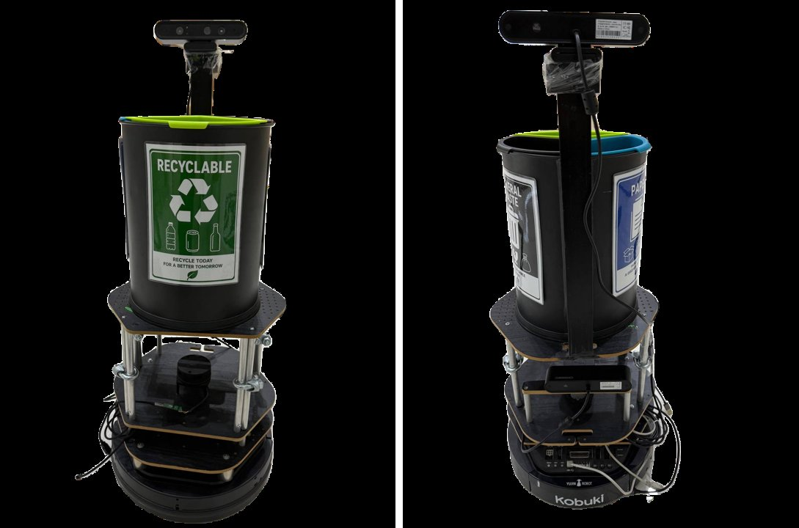
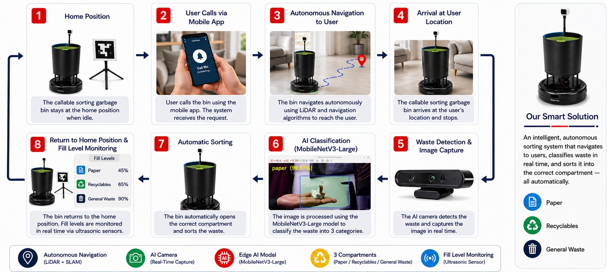
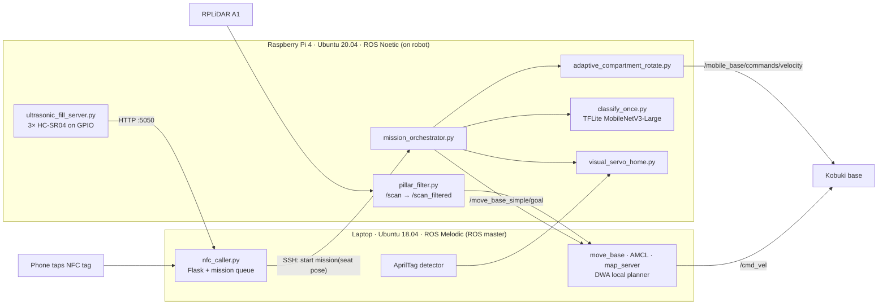
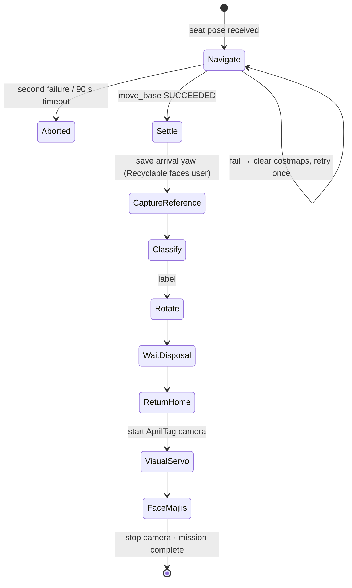
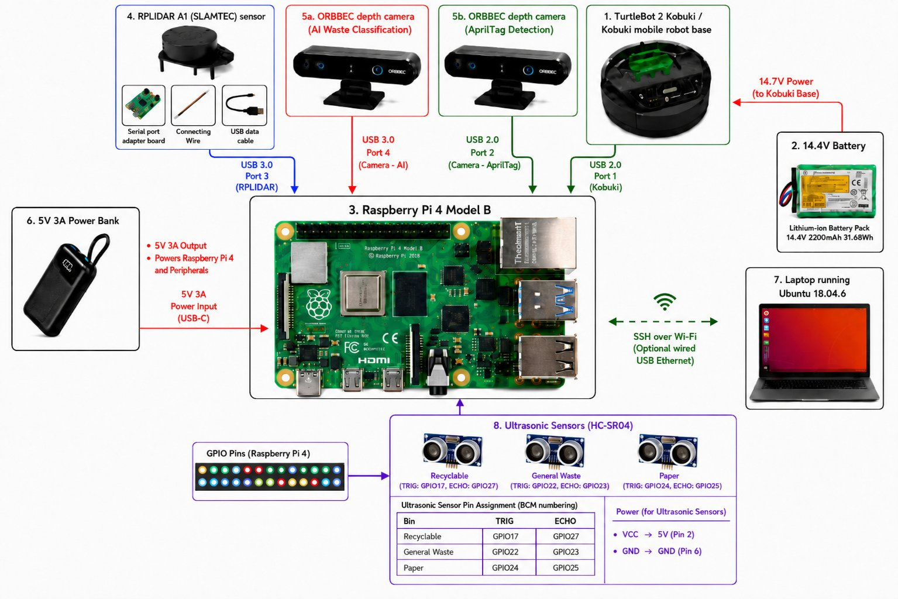

# Callable Sorting Garbage Bin

An indoor autonomous mobile robot that comes to you when you tap an NFC tag at your seat. It identifies the waste you hold up with an on-board camera and a MobileNetV3 classifier, then turns to present the right compartment. Afterwards it drives back and docks at its home station using an AprilTag.

Capstone project, B.Sc. Computer Engineering, Abu Dhabi University, 2025–2026.
**3rd Place, 13th Undergraduate Research & Innovation Competition (URIC 2026).**



---

## How it works

1. **Call:** an NFC tag on each seat opens a web page served by the laptop (Flask). Pressing **Call Robot** queues a mission for that seat.
2. **Navigate:** the Raspberry Pi runs the mission. It sends the seat pose to `move_base` (AMCL localisation on a gmapping SLAM map, with the DWA local planner).
3. **Classify:** at the seat, the AI camera captures the item. A MobileNetV3-Large TensorFlow Lite model running on the Pi labels it as **Recyclable**, **Paper** or **General Waste**.
4. **Present the compartment:** the three compartments sit 120° apart, so the whole robot rotates in place under closed-loop control on AMCL yaw until the right one faces the user.
5. **Return and re-anchor:** the robot drives back to HOME. An AprilTag visual servo docks it precisely, then it re-publishes the initial pose so AMCL drift is reset before the next mission.
6. **Monitor fill level:** three HC-SR04 ultrasonic sensors report each compartment's fill level to the seat web page.





### Mission sequence (`robot_pi/mission_orchestrator.py`)



---

## Hardware

| Component | Role |
|---|---|
| Kobuki (TurtleBot 2) base | Differential-drive platform, odometry |
| Raspberry Pi 4 (8 GB) | On-board computer: ROS Noetic, mission logic, AI inference, GPIO |
| RPLiDAR A1 | 360° scans for mapping, localisation and obstacle avoidance |
| 2× Orbbec cameras | One for waste classification, one for AprilTag docking |
| 3× HC-SR04 | Compartment fill level (echo lines through 1 kΩ / 2 kΩ voltage dividers to 3.3 V GPIO) |
| Laptop | ROS master, navigation stack, AprilTag detection, Flask server |
| Portable Wi-Fi router | Private network shared by the laptop and the Pi |



> The GPIO pin numbers in `robot_pi/ultrasonic_fill_server.py` are the ones the robot actually used. The bin labels in the diagram above differ slightly from the code, so trust the code.

---

## Engineering decisions worth noting

- **Jetson Nano → Raspberry Pi 4.** The classifier was first deployed on a Jetson Nano. The team then tested whether the Pi alone could run the converted TFLite model fast enough for this use case. It could, so the Jetson was removed, which cut cost, power and wiring.
- **Rotate the robot, not the bins.** The compartments are fixed 120° apart and the base turns in place. That needs no extra actuator, and it reuses the localisation the robot already has.
- **Closed-loop rotation instead of timed turns.**
  - `adaptive_compartment_rotate.py` is a proportional controller on AMCL yaw: gain 1.5, output capped at ±0.45 rad/s, ±3° tolerance.
  - It counts as settled only after 10 consecutive in-tolerance cycles at 20 Hz.
  - Every target is computed from the yaw saved on arrival, not from the previous turn, so errors don't accumulate across classifications.
- **Self-detection filter.** The bin's support pillars sit inside the LiDAR's field of view. Rather than move them, `pillar_filter.py` blanks returns that are both inside known angle bands *and* closer than 0.30 m. Real walls at the same angles still get through, so localisation is unaffected.
- **One camera at a time.** Two USB cameras streaming at once exceeded the Pi's USB power budget. The orchestrator starts the AprilTag camera only for docking and shuts it down afterwards.
- **Drift reset every cycle.** AMCL drift built up over several missions. AprilTag docking followed by re-publishing `/initialpose` re-anchors localisation at HOME.

---

## Results

These are from the final thesis report, June 2026.

| Test | Result |
|---|---|
| HOME docking (AprilTag visual servo), 5 trials | 5/5 inside the HOME marker; final position error ≤ 18 mm; yaw within 2° of target |
| Compartment rotation | Correct compartment presented for all three classes from any starting orientation |
| Waste classifier (MobileNetV3-Large, deployed model) | 98.14 % test accuracy on 1,612 test images (3 classes) |
| Capstone 1 MobileNetV3 on TrashNet (3 classes) | 93.3 % test accuracy before Optuna tuning → 97.5 % after (283 test images) |

**Read the classifier numbers with care.** In both training pipelines, offline augmentation for class balancing was applied *before* the train/validation/test split. Augmented copies of the same photo can therefore end up in both training and test sets, which probably makes these accuracies optimistic. Retraining with the split done first is listed under future work.

---

## Repository layout

The two top-level folders mirror the home directories on each machine. Copy each one to `~` on that machine; the scripts use `~/...` paths.

```
laptop/                         → laptop home directory (ROS master)
  nfc_caller.py                 Flask seat page + serialized mission queue; starts missions on the Pi over SSH
  fill_routes.py                Fill-level widget routes (reads the Pi's :5050 server)
  fine_rotation_node.py         Post-goal yaw correction on AMCL feedback
  visual_servo_home.py          AprilTag docking controller
  home_localize.py, reanchor.py Publish /initialpose at HOME
  annotate_table.py             Draws the LiDAR-invisible glass table onto the map
  kobuki_launch/                kobuki_nav.launch (AMCL + move_base + map), kobuki_slam_v3.launch (gmapping)
  kobuki_nav_config/            Costmap, move_base and DWA parameters; seat waypoints
  kobuki_apriltag/              AprilTag detector launch, tag config, HOME target pose
  maps/                         majlis_v3 (home Majlis) and majlis_uni_v1 (university demo)

robot_pi/                       → Raspberry Pi home directory (on the robot)
  mission_orchestrator.py       Main mission state machine
  adaptive_compartment_rotate.py Closed-loop compartment rotation
  rotate_to_home_yaw.py         Turns back to face the Majlis after docking
  visual_servo_home.py          AprilTag docking (Pi side)
  ultrasonic_fill_server.py     3× HC-SR04 → JSON fill levels on :5050
  waste_ai/classify_once.py     Captures frames, runs the TFLite model, prints the label
  kobuki_ws/kobuki_pi_launch/   RPLiDAR and Orbbec launch files, pillar_filter.py
  system_config/                udev rules, chrony, hosts, netplan (Wi-Fi credentials removed)

ml/
  capstone1_mobilenetv3_trashnet_optuna.ipynb  MobileNetV3 on TrashNet: training, testing, Optuna, retraining
  capstone2_mobilenetv3large_train.py          Final MobileNetV3-Large training script (deployed model)
```

Trained model files (`.keras`, `.tflite`) and datasets are not in this repository because of their size.

---

## Running it (summary)

Full bring-up order, from the team's running checklist:

1. **Laptop:** run `roscore`. Set `ROS_MASTER_URI` and `ROS_HOSTNAME` on both machines.
2. **Pi:** `roslaunch kobuki_node robot_with_tf.launch`, then `roslaunch kobuki_pi_launch rplidar.launch`, then `python3 pillar_filter.py`.
3. **Laptop:**
   - Static TF from `base_footprint` to `laser`.
   - `roslaunch ~/kobuki_launch/kobuki_nav.launch`.
   - `fine_rotation_node.py`.
   - `sync_camera_info.py` and `apriltag_detect.launch`.
4. **Pi:** `sudo python3 ~/ultrasonic_fill_server.py`. It needs root for GPIO.
5. **Laptop:** `python nfc_caller.py`, then open `http://<laptop-ip>:5000/call?seat=A`.
6. **Health check before dispatching:**
   - `/odom` at about 50 Hz.
   - `/scan_filtered` at about 7 Hz.
   - `/tf` at 80–100 Hz.
   - `/amcl_pose` publishing.

IP addresses in the scripts (192.168.0.156 for the laptop, .158 for the Pi) match the team's private router. Change them for your own network.

**Dependencies:**
- **Laptop:** ROS Melodic, `navigation`, `gmapping`, `apriltag_ros`, Flask.
- **Pi:** ROS Noetic, the [Kobuki driver](https://github.com/yujinrobot/kobuki), `rplidar_ros`, the Orbbec ROS driver, `tflite_runtime`, OpenCV, Pillow, `RPi.GPIO`, Flask.

---

## Limitations and future work

- **Pose estimate:** navigation reliability depends on the quality of the pose estimate. Far seats occasionally failed when drift pushed the robot's footprint into an occupied cell of the static map. Slower in-place rotations and re-localising after each turn would help.
- **Test protocol:** test accuracy should be re-measured with augmentation applied only after the split, and validated on photos taken by the robot's own camera.
- **Prototype security:** mission start uses SSH with host-key checking disabled, and the Flask servers listen on all interfaces. That is acceptable on a private router but not for deployment.
- **ROS 1:** the project is built on ROS 1, which reached end of life in 2025. Porting to ROS 2 (Nav2) is the natural next step.

---

## Team

Hala Samer Chikh Aljabal (team lead), Yasmin Magdy Loksha, Shahd R. W. Ghazal, Hamad Abdulla Alnuaimi and Abdulla Manea Al Ahbabi.
Supervised by Prof. Mohammed Ghazal, Abu Dhabi University.

### My contributions (Yasmin Magdy Loksha)

- Wrote **`mission_orchestrator.py`**, the state machine that sequences navigation, classification, rotation and return to HOME.
- Wrote the **compartment-rotation control** (`adaptive_compartment_rotate.py`).
- Deployed the classifier on the **Jetson Nano**, then **converted the final model to TensorFlow Lite** for on-board Raspberry Pi inference.
- Trained the **Capstone 1 MobileNetV3** model on TrashNet, with Optuna hyperparameter tuning (`ml/capstone1_mobilenetv3_trashnet_optuna.ipynb`).
- **Sensor integration**, the first prototype draft, **SLAM mapping**, and **experimental testing and results recording**.

The final MobileNetV3-Large model and the other subsystems were developed by teammates, as described in the thesis.
